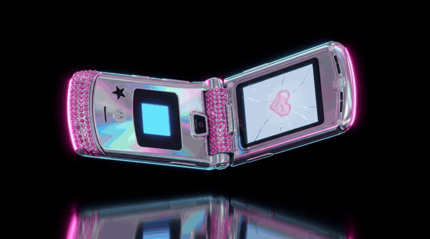
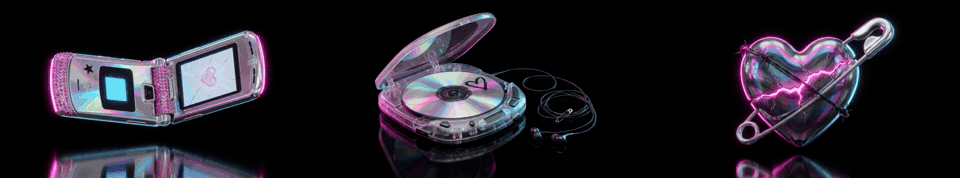
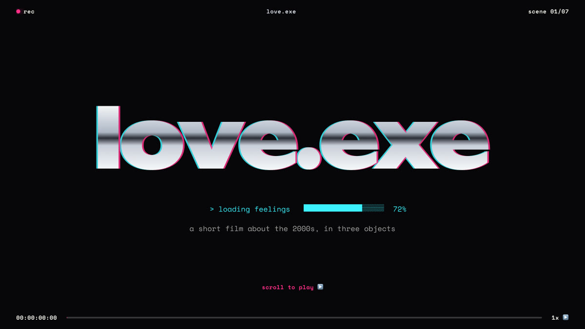
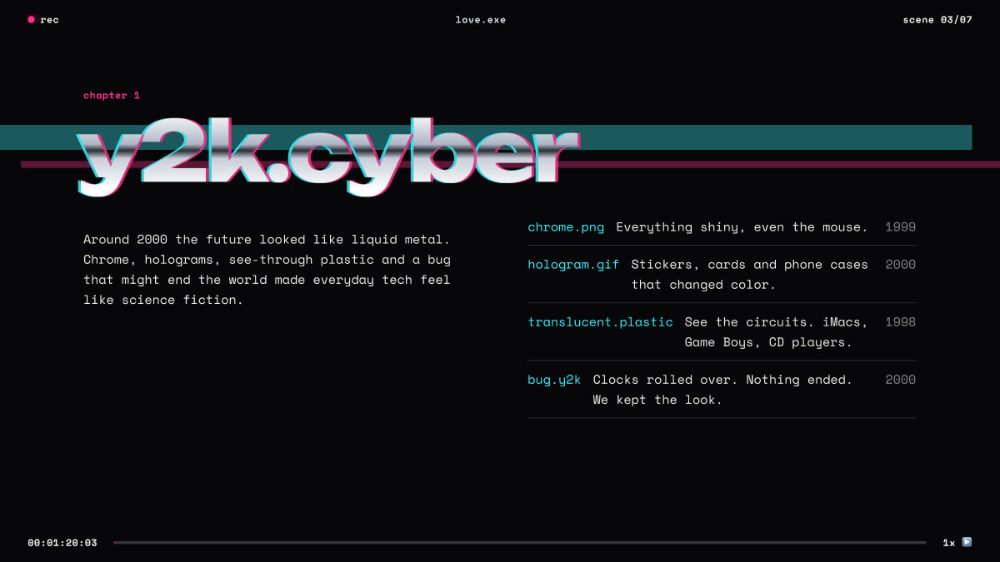
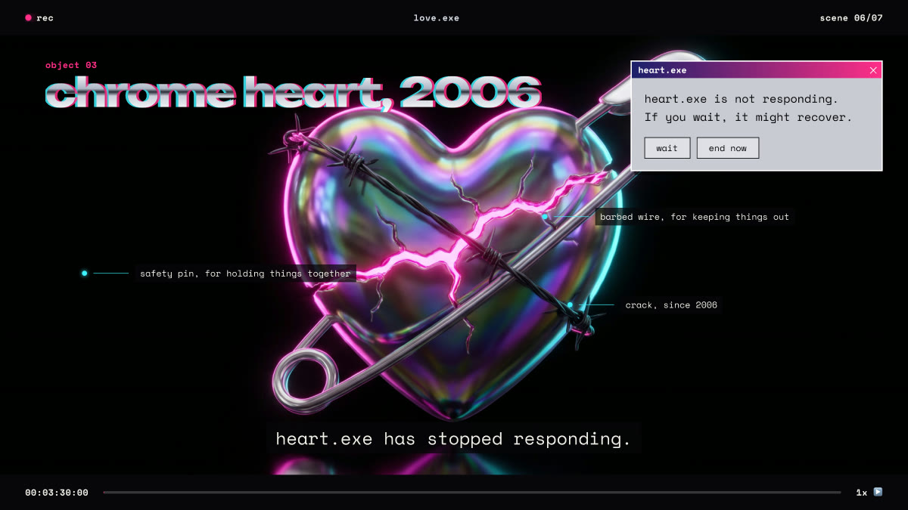
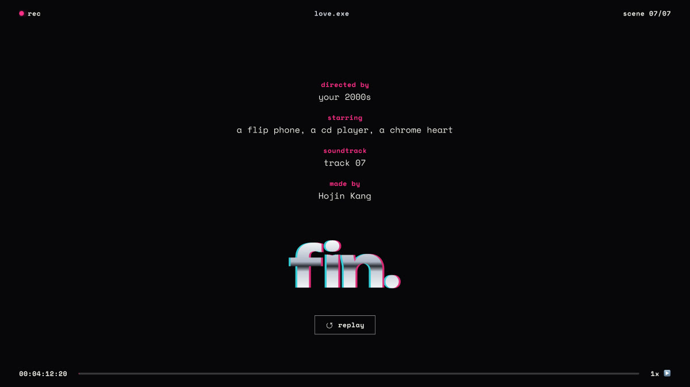
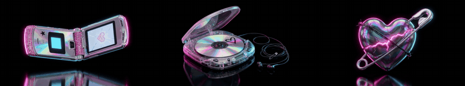
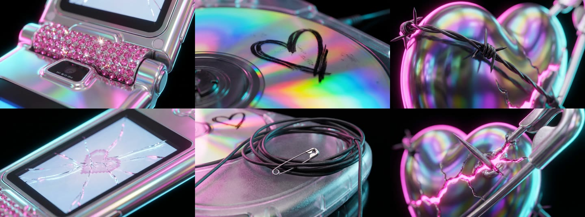
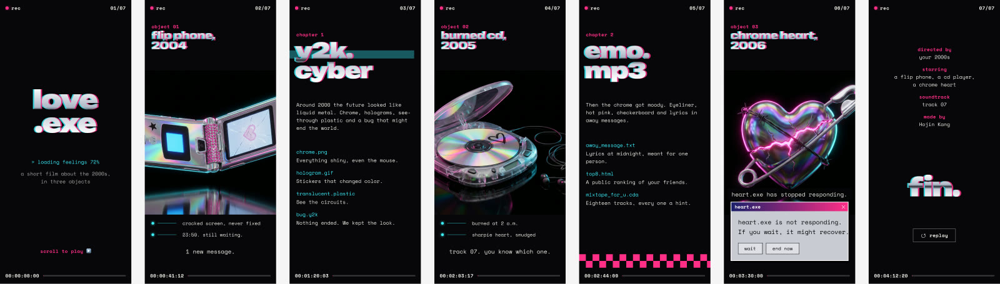
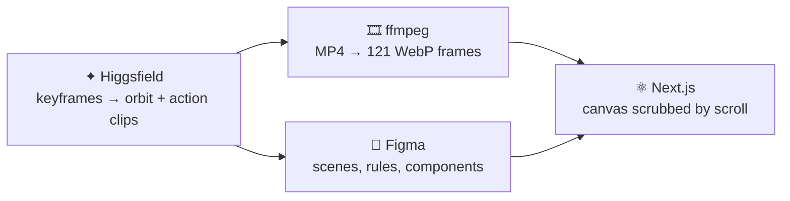

<div align="center">



# love.exe

**a short film about the 2000s, in three objects**

Y2K chrome meets emo heartbreak. A landing page that plays like an edited music video:<br />
scroll, and a flip phone, a burned CD and a chrome heart turn in front of you, one frame at a time.

<br />

[](https://github.com/202021042khj/y2k-emo-fe/actions/workflows/ci.yml)


<sub>rec ● &nbsp;00:00:00:00 &nbsp;━━━━━━━━━━━━━━━━━━━━━━ &nbsp;scene 01/07</sub>

</div>

---

## ▶ What it is

`love.exe` is not a website that scrolls. It is a seven-scene short film that you scrub with your scroll wheel.

- **Every scene fills the screen** and the page snaps from cut to cut.
- **A camcorder overlay never leaves**: letterbox bars, a blinking `rec` dot, a running timecode, a scene counter and a scrub bar that track your progress through the whole film.
- **Three objects get an Apple-style product reveal**: the camera orbits each one a full 360° while the scene is pinned, and callouts appear at set angles.
- **Each object has its own detail film** at `/objects/phone`, `/objects/cd` and `/objects/heart`, with a Windows 2000 properties box, two macro shots and an action clip.

<div align="center">

<br /><sub>the three orbits, as scrubbed by scroll</sub>
</div>

## 🎬 The scenes

| # | Scene | What happens |
|:-:|---|---|
| 01 | **cold open** | `love.exe` types itself out in liquid chrome while feelings load to 72% |
| 02 | **flip phone, 2004** | 360° orbit · *"1 new message."* |
| 03 | **chapter 1 — `y2k.cyber`** | chrome, holograms, see-through plastic and the millennium bug, as a directory listing |
| 04 | **burned cd, 2005** | 360° orbit · *"track 07. you know which one."* |
| 05 | **chapter 2 — `emo.mp3`** | eyeliner, hot pink, checkerboard and away messages |
| 06 | **chrome heart, 2006** | 360° orbit · *"heart.exe has stopped responding."* with a real error dialog |
| 07 | **end credits** | rolling credits, `fin.` and a replay button |

<table>
  <tr>
    <td></td>
    <td></td>
  </tr>
  <tr>
    <td></td>
    <td></td>
  </tr>
</table>

## 🔍 Object detail films

Every object opens into a five-scene film of its own.

```
orbit + properties.exe  →  macro detail 01  →  action clip  →  macro detail 02  →  next object
```

<div align="center">

<br /><sub>action clips — <i>"it lit up. it was not them."</i> · <i>"press play. skip to 07."</i> · <i>"it still beats. it just glows now."</i></sub>
<br /><br />

<br /><sub>macro details</sub>
</div>

## 📱 On a phone

The same film, recut for portrait: orbits are fitted instead of cropped, callouts become a list under the object, and the heart's error dialog takes their place.

<div align="center">

</div>

## 🛠 How it was made

Every visual on the page was generated, designed and then rebuilt as real, accessible markup.



1. **Generate** — product-style keyframes with Nano Banana, then 5-second Kling 3.0 clips. Orbits use the same image as the first *and* last frame, so the camera comes all the way back around.
2. **Extract** — each clip becomes 121 WebP frames at 1280px (≈2–3 MB per object) plus a poster still.
3. **Design** — Figma holds the design rules page (palette, type, materials, motion and accessibility rules), seven 16:9 desktop scenes, seven mobile scenes and the detail films.
4. **Build** — scenes are Next.js sections; a canvas draws the frame that matches the scroll position.

<details>
<summary><b>How the scroll scrubbing works</b></summary>

<br />

`components/common/love/FrameScrubCanvas.tsx`

- `useScroll` from Motion gives 0–1 progress through a pinned `250vh` section; that maps to a frame index.
- Frames load **every 4th frame first**, then fill the gaps, so scrubbing works almost immediately.
- The canvas draws the nearest frame that has loaded, cover-fitted on desktop and width-fitted (1.95×) on phones.
- Desktop and mobile trees both mount and CSS picks one, so frames only load once the canvas is **near the viewport and actually rendered**. The hidden copy never downloads a thing.
- A poster image sits underneath, so there is always a picture, and it is all you get with reduced motion.

</details>

<details>
<summary><b>Design rules, in short</b></summary>

<br />

| Token | Hex | Role |
|---|---|---|
| void | `#07060A` | the black everything sits on |
| chrome | `#D9DDE6` | display type, metal |
| hot pink | `#FF2E88` | rec dot, progress, the crack's glow |
| cyber blue | `#3DF2FF` | callouts, file names |
| bruise | `#5B2A86` | holographic shadow |
| paper | `#F2EFE9` | subtitles and body |

- **Type** — [Unbounded](https://fonts.google.com/specimen/Unbounded) for display, always liquid chrome with a cyan/pink split; [Space Mono](https://fonts.google.com/specimen/Space+Mono) for everything else, like a camcorder overlay.
- **Motion** — scroll drives everything. One glitch cut per chapter; nothing else moves on its own.
- **Accessibility** — the overlay is decorative and hidden from screen readers; each scene is a section with a real heading; dialogs use real links; focus rings are visible; `prefers-reduced-motion` turns off snapping, glitches and orbits.

Full plan in [`docs/DESIGN.md`](docs/DESIGN.md).

</details>

## ⚡ Getting started

```bash
git clone https://github.com/202021042khj/y2k-emo-fe.git
cd y2k-emo-fe
npm install
npm run dev
```

Open [http://localhost:3000](http://localhost:3000) and scroll slowly.

| Command | What it does |
|---|---|
| `npm run dev` | dev server with Turbopack |
| `npm run build` | production build; all pages are prerendered static HTML |
| `npm run start` | serve the production build |
| `npm run lint` | ESLint |

No environment variables are needed. Everything the page shows is a static file in `public/`.

## 🗂 Project structure

```
app/
├── (main)/page.tsx                  # the film  →  /
└── (main)/objects/[slug]/page.tsx   # detail films  →  /objects/phone | cd | heart

components/
├── common/love/       # FrameScrubCanvas, CamcorderOverlay, OrbitScene, ChromeTitle,
│                      # ErrorDialog, PropertiesDialog, FileList
├── pages/main/        # Desktop/Mobile pages + cold open, chapter and credits sections
├── pages/object-detail/
└── ui/                # design system from the starter template

constants/love.ts      # every scene's copy, callouts, credits and frame sequences
types/love.ts
public/frames/         # orbit and action frame sequences + posters
public/details/        # macro stills
docs/DESIGN.md         # design plan
```

Generated originals (MP4s, full-size PNGs) live in `assets-source/`, which is git-ignored.

## ✅ CI

GitHub Actions runs **type check → lint → build** on every push and pull request to `dev` and `prod`. See [`.github/workflows/ci.yml`](.github/workflows/ci.yml).

## 🎞 Credits

<div align="center">

<sub>directed by</sub><br />
**your 2000s**

<sub>starring</sub><br />
**a flip phone, a cd player, a chrome heart**

<sub>soundtrack</sub><br />
**track 07**

<sub>made by</sub><br />
**Hojin Kang**

<br />

<sub>built from a personal Next.js starter · visuals generated with Higgsfield · designed in Figma</sub>

<br /><br />

**fin.**

</div>
